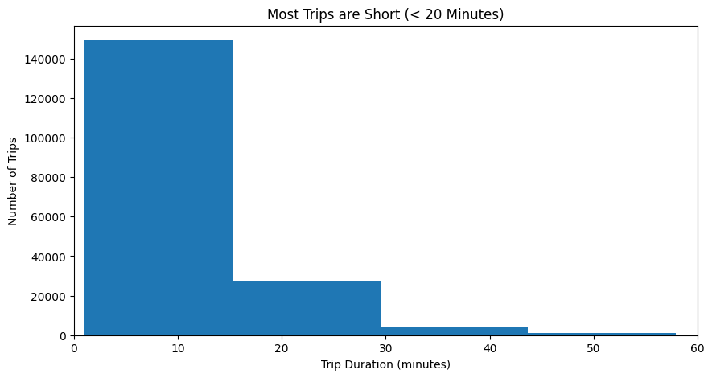
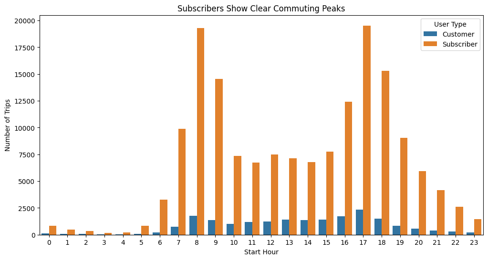
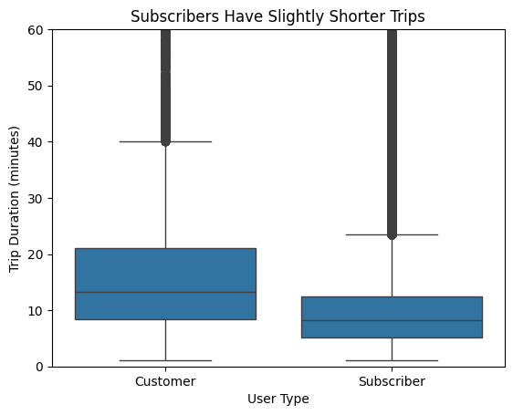

# Communicate Data Findings 

## Project Overview
This project explores and communicates insights from the **Bay Wheels / Ford GoBike** bike-sharing dataset.  
The analysis is conducted in two main phases:

1. **Exploratory Data Analysis (Part I)**  
   In this phase, I examined and explored the dataset to understand its structure, identify patterns, and detect relationships between variables.

2. **Explanatory Data Analysis (Part II)**  
   After identifying meaningful insights, I refined and presented the most important findings through clear and focused visualizations.

The main goal of the project is to move from **understanding the data** to **explaining the results clearly**.

---

## Dataset
The dataset contains trip records from a bike-sharing system in the **San Francisco Bay Area**, including:

- Start and end station
- Trip duration
- Date and time of the trip
- User type (Subscriber / Customer)

This dataset allows us to explore:
- When people ride bikes the most
- How long trips typically last
- How behavior differs between casual users and subscribers

The analyzed file has 183,412 trips and 16 columns. It is not included in this repository.

---

## Part I: Exploratory Data Analysis
**File:** `Part_I_exploration_template.ipynb`

### What I did:
- Loaded the dataset and checked data structure, datatypes, and missing values.
- Cleaned data where necessary (fixing formats such as datetime, removing/imputing missing records).
- Created visualizations to explore:
  - Trip duration distribution
  - Peak usage times during the day and week
  - Comparison between **Subscribers** and **Customers**
  - Difference in trip behavior across different hours

### Key Insights Found:
- Most bike trips are **short**, typically under 20 minutes.
- **Subscribers** use the service for **commuting**, mainly during **morning and evening rush hours**.
- **Customers (Casual Users)** tend to take **longer trips**.
- Usage patterns strongly reflect work schedules and lifestyle differences.

---

## Part II: Explanatory Visualization
**File:** `Part_II_explanatory_template.ipynb`

### What I did:
- Selected the most **important** insights from the exploratory phase.
- Created polished, presentation-ready graphs.
- Added labels, titles, and annotations to make the visual message clear.

### Insights Communicated:
1. **Trip Duration Distribution**  
   - Most users ride for short durations, and longer trips are less common.

   

2. **Rush Hour Usage (Subscribers)**  
   - Clear peaks appear around **8 AM** and **5 PM**, which fits a work commute pattern.

   

3. **Trip Duration by User Type**  
   - Customers tend to take longer trips than Subscribers.

   

The visual storytelling highlighted how **user type strongly influences how and when bikes are used**.

---

## How to Run
The dataset is not included in this repository. The notebooks show saved results. To run them again, download the Ford GoBike trip data, save it as `fordgobike.csv` next to the notebooks, and run:

```bash
git clone https://github.com/JumanahAlmatrood/Communicate-Data-Findings.git
cd Communicate-Data-Findings
pip install jupyter pandas numpy matplotlib seaborn
jupyter notebook
```

---

## Tools and Libraries
- Python
- Pandas
- NumPy
- Matplotlib
- Seaborn
- Jupyter Notebook

---

## What I Learned
- How to separate **exploration** from **communication** in data analysis.
- How to design visualizations that tell a story rather than just show data.
- How user behavior can be clearly observed through **time patterns** and **group comparison**.
- The importance of clarity, simplicity, and purpose in data presentation.


